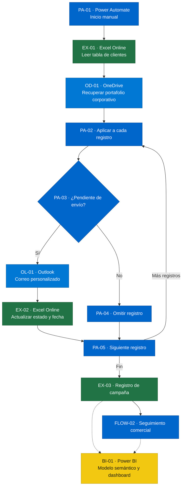
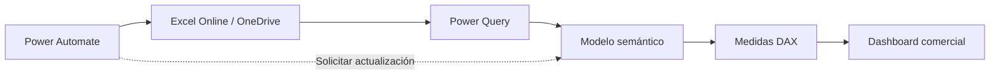

# Sistema de Automatización Comercial e Inteligencia de Negocios

### Microsoft 365 · Power Platform · Business Intelligence


**Automatización de procesos | Trazabilidad | Analítica comercial**

</div>

## 01 · Resumen ejecutivo

Solución orientada a automatizar la presentación comercial personalizada, el envío del portafolio corporativo de soluciones TI y el seguimiento de clientes. Los registros se gestionan en Excel Online y Power Automate actualiza su estado y fecha de envío para evitar repetir la presentación en ejecuciones posteriores. La capa analítica integra Power Query, DAX y Power BI para representar la cobertura y evolución de la campaña en un escenario de demostración.

## 02 · Arquitectura funcional

<div align="center">

</div>

### Secuencia técnica



La línea discontinua representa la transferencia de datos hacia la capa analítica del escenario de demostración. Los identificadores son referencias de documentación, no IDs internos de Microsoft.

## 03 · Módulos y lógica de negocio

| ID | Componente | Responsabilidad | Estado |
|---|---|---|---|
| FLOW-01 | Presentación comercial | Leer contactos, personalizar correo, enviar portafolio y registrar envío | Desarrollado |
| FLOW-02 | Seguimiento | Enviar recordatorio comercial mediante un flujo independiente | Desarrollado; reglas por confirmar |
| BI-01 | Power BI | Consumir registros y calcular indicadores DAX | Modelo de demostración |
| FLOW-03 | Respuestas | Registrar respuestas y resultados comerciales | Modelo de demostración |
| FLOW-04 | Actualización BI | Solicitar actualización del modelo al finalizar una campaña | Modelo de demostración |
| FLOW-05 | Reporte gerencial | Distribuir resumen periódico de indicadores | Modelo de demostración |

## 04 · Estructura de datos y diccionario

Los seis campos operativos están respaldados por las capturas del flujo; los demás forman parte del esquema analítico de demostración.

Una fila representa un registro de contacto, no necesariamente una empresa única. La tabla de Excel debe tener encabezados y un ITEM único y estable.

| Columna | Tipo | Uso | Estado |
|---|---|---|---|
| ITEM | Texto | Clave del registro | Actual |
| CLIENTE | Texto | Empresa | Actual |
| CONTACTO | Texto | Persona | Actual |
| CORREO | Texto | Destinatario | Actual |
| ESTADO | Texto | Control de presentación | Actual |
| FECHA_ENVIO | Fecha/hora | Registro de envío | Actual |
| FECHA_REGISTRO | Fecha | Alta del contacto | Modelo de demostración |
| DEPARTAMENTO | Texto | Análisis territorial | Modelo de demostración |
| SEGMENTO | Texto | Clasificación comercial | Modelo de demostración |
| ESTADO_RECORDATORIO | Texto | Control de seguimiento | Modelo de demostración |
| FECHA_RECORDATORIO | Fecha/hora | Fecha de seguimiento | Modelo de demostración |
| RESPUESTA | Texto | Respuesta registrada | Modelo de demostración |
| REUNION | Texto | Reunión concertada | Modelo de demostración |
| OPORTUNIDAD | Texto | Oportunidad generada | Modelo de demostración |

## 05 · Integración con Power BI

<div align="center">

</div>



1. En Power BI Desktop, seleccionar Obtener datos > Carpeta de SharePoint.
2. Introducir la URL raíz del sitio de OneDrive empresarial o SharePoint, no el enlace de uso compartido del archivo.
3. Autenticarse con cuenta organizacional, filtrar el archivo y abrir su contenido con Excel.Workbook. Seleccionar la tabla de clientes.
4. Limpiar estados, establecer tipos de datos y nombrar la consulta `Clientes`.
5. Crear medidas DAX, visualizaciones y publicar en un espacio de trabajo autorizado.
6. Configurar credenciales y actualización del modelo en Power BI Service. Opcionalmente, solicitar una actualización al terminar el flujo completo, no por cada cliente.

## 06 · Indicadores DAX

Las siguientes medidas cuentan registros únicos por ITEM. Se asume una fila válida por ITEM y que ENVIADO es el estado final de la presentación inicial. Ajustar los nombres y estados al esquema real antes de implementar.

```dax
Total Registros = DISTINCTCOUNTNOBLANK(Clientes[ITEM])

Presentaciones Enviadas =
COALESCE(CALCULATE([Total Registros], Clientes[ESTADO] = "ENVIADO"), 0)

Pendientes =
COALESCE(CALCULATE([Total Registros],
    FILTER(Clientes, ISBLANK(Clientes[ESTADO]) || Clientes[ESTADO] = "" || Clientes[ESTADO] = "PENDIENTE")), 0)

Otros Estados = [Total Registros] - [Presentaciones Enviadas] - [Pendientes]

Cobertura Campaña = DIVIDE([Presentaciones Enviadas], [Total Registros], 0)
```

Formatear Cobertura Campaña como porcentaje. Los siguientes indicadores utilizan las columnas de seguimiento del modelo de demostración; requieren datos registrados para producir resultados reales.

```dax
Recordatorios Enviados =
COALESCE(CALCULATE([Total Registros], Clientes[ESTADO_RECORDATORIO] = "ENVIADO"), 0)

Respuestas Recibidas =
COALESCE(CALCULATE([Total Registros], Clientes[RESPUESTA] = "SI"), 0)

Reuniones Concertadas =
COALESCE(CALCULATE([Total Registros], Clientes[REUNION] = "SI"), 0)

Oportunidades Generadas =
COALESCE(CALCULATE([Total Registros], Clientes[OPORTUNIDAD] = "SI"), 0)

Tasa Respuesta = DIVIDE([Respuestas Recibidas], [Presentaciones Enviadas], 0)
```

Para analizar envíos diarios, crear una columna de fecha sin hora y relacionarla con una dimensión calendario. Los indicadores de seguimiento deben conservar el estado original de presentación; no sobrescribir ENVIADO con RECORDATORIO.

## 07 · Diseño del dashboard

| Visual | Indicador |
|---|---|
| Tarjetas KPI | Total, enviados, pendientes, cobertura |
| Gráfico de anillo | Distribución de estados |
| Gráfico de columnas | Presentaciones por fecha |
| Barras horizontales | Recordatorios, respuestas, reuniones y oportunidades |
| Segmentadores | Fecha, departamento, segmento |
| Tabla operativa | ITEM, cliente, estado y fechas (solo acceso autorizado) |

<div align="center">

</div>

### Lectura de indicadores — escenario simulado

| Indicador | Resultado | Interpretación |
|---|---:|---|
| Registros | 500 | Universo de contactos |
| Presentaciones enviadas | 420 | Registros procesados |
| Pendientes | 80 | Registros sin envío |
| Cobertura | 84 % | 420 / 500 |
| Recordatorios | 180 | Contactos con seguimiento |
| Respuestas | 75 | Contactos con respuesta registrada |
| Reuniones | 30 | Contactos con reunión registrada |
| Oportunidades | 18 | Contactos con oportunidad registrada |

Los envíos diarios de la simulación (65, 95, 110, 80 y 70) suman 420. Los indicadores de seguimiento no prueban causalidad ni constituyen resultados de producción.

## 08 · Seguridad, calidad y escalabilidad

- No publicar bases de clientes, correos reales, documentos internos ni credenciales.
- Validar identificadores únicos y habilitar paginación si el volumen supera el límite de lectura de la acción de Excel.
- Evitar ejecuciones simultáneas sobre los mismos registros. Un envío exitoso seguido de una actualización fallida puede provocar reenvíos; registrar errores y reconciliar antes de reintentar.
- ENVIADO indica ejecución exitosa de la acción de envío, no entrega ni lectura confirmada.
- Respetar consentimiento, exclusiones y límites de correo de Microsoft 365. No utilizarlo como plataforma de marketing masivo de alto volumen.
- Power BI usa actualización programada o bajo demanda; no se garantiza tiempo real. Licencias y permisos dependen del entorno.
- Alternativas de escalabilidad: SharePoint Lists para gestión colaborativa o SQL Server para persistencia transaccional y mayor volumen. SQL Server local puede requerir gateway; el conector SQL de Power Automate puede requerir licencia premium.

## 09 · Evidencia técnica

<div align="center">

</div>

La captura muestra el desencadenador manual, lectura de Excel, recuperación de archivos, iteración, condición, envío y actualización de fila. El flujo independiente de recordatorio fue descrito por el autor; su condición exacta no se incluye en esta documentación.

## 10 · Alcance de la demostración

Los flujos comerciales corresponden al desarrollo descrito por el autor. La arquitectura analítica, las medidas DAX y los gráficos documentan un escenario reproducible con datos ficticios; no son evidencia de una conexión de producción validada ni de resultados comerciales reales. Los identificadores son etiquetas de documentación.
